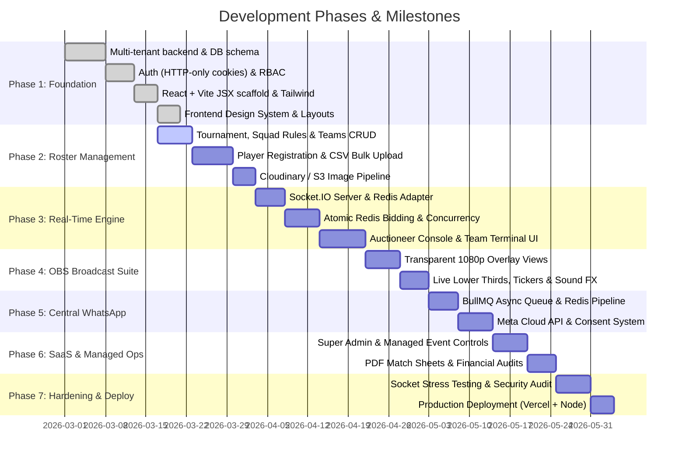

# Cricket Auction Management Platform - Development Roadmap

## 1. Roadmap Overview & Timeline

The platform will be built across **7 distinct, sequential phases**. Each phase produces a verifiable milestone before advancing to downstream dependencies.

---

## 2. Phase-by-Phase Breakdown

### Phase 1: Core Foundation & Multi-Tenancy
- **Objectives**: Establish secure infrastructure, data persistence, and tenant isolation.
- **Deliverables**:
  - Node.js + Express modular scaffold with unified error handling.
  - MongoDB Atlas Mongoose connection with schemas (`organisations`, `users`, `tournaments`, etc.).
  - JWT authentication using HTTP-only, secure, SameSite cookies (access + refresh tokens).
  - RBAC and tenant context injection middleware (`requireTenantContext`, `requireRole`).
  - React + Vite JSX frontend scaffold with Tailwind CSS, custom design tokens, and basic layout components.
- **Success Criteria**: A user can log in securely; tenant context is automatically bound to subsequent requests.

### Phase 2: Tournament & Player Registration System
- **Objectives**: Complete end-to-end management of tournaments, franchises, and player pools.
- **Deliverables**:
  - Tournament creation wizard with squad composition constraints and custom bid increment ladders.
  - Team management with starting purse and manager assignment.
  - Public player self-registration portal with mandatory WhatsApp consent capture.
  - Bulk player CSV import and validation engine.
  - Headshot image upload to Cloudinary/S3 with automatic square cropping.
  - Player categorization (Icon, Platinum, Gold, etc.) and lot sequencing tools.
- **Success Criteria**: 100+ players can be imported via CSV, verified, ordered into lots, and associated with a tournament.

### Phase 3: Real-Time Auction Engine & Socket.IO
- **Objectives**: Low-latency, high-concurrency bidding engine with zero race conditions.
- **Deliverables**:
  - Socket.IO cluster setup with Redis adapter.
  - Distributed Redis locking (`tournament:lock:ID`) to serialize simultaneous bids.
  - Server-authoritative timer with auto-tick broadcasts (`auction:timer_tick`).
  - Auctioneer Console: Start auction, advance lots, pause, hammer calls (Going Once/Twice/Sold/Unsold), bid overrides.
  - Team Bidder Terminal: Real-time one-click bidding, remaining purse calculator, max-permissible-bid cap.
  - Audio sound effects: Gavel strike, new high bid alert, countdown tick.
- **Success Criteria**: 10 concurrent bidders placing simultaneous bids without purse overdraft or out-of-order sequence issues.

### Phase 4: OBS Broadcast Overlay Suite
- **Objectives**: Broadcast-grade, transparent graphics for live streaming to YouTube/Facebook Live.
- **Deliverables**:
  - 1080p full-screen transparent web route (`/overlay/live/:tournamentId?key=...`).
  - Active Player Lower-Third: High-resolution photo, cricket role, batting/bowling style, career stats, base price.
  - Live Bid Alert: Dynamic pop-up badge with current highest bid and team branding colors.
  - Team Purse Leaderboard: Compact side widget showing remaining purse and squad slots filled for all franchises.
  - Live Ticker: Bottom ticker scrolling recent buys and upcoming lots.
- **Success Criteria**: OBS Studio loads the browser source with 100% transparency and renders 60fps animations upon bid updates.

### Phase 5: Central WhatsApp Notification & Worker Engine
- **Objectives**: Reliable, asynchronous player alerts via one central platform WhatsApp Business Account.
- **Deliverables**:
  - BullMQ Redis queue (`whatsapp-queue`) with concurrency throttling and retry policies.
  - Meta WhatsApp Cloud API integration with Graph API v19+.
  - Automated WhatsApp message templates:
    1. Player Registration Confirmation & Consent Ack.
    2. Player Under the Hammer Notification.
    3. Player Sold / Unsold Result Notification.
    4. Official Squad Roster Announcement.
  - Inbound webhook processor for STOP/opt-out replies with immediate database consent revocation.
- **Success Criteria**: Player receives WhatsApp message within 3 seconds of being sold; replying STOP automatically revokes consent.

### Phase 6: Managed Auction Services & Commercial SaaS Controls
- **Objectives**: Enable platform operators to run managed auction events and oversee SaaS tenants.
- **Deliverables**:
  - Platform Super Admin Dashboard: Tenant management, managed event dispatching, WhatsApp cost ledger.
  - Platform Auctioneer operational workflow: Step-in permissions to run client auctions smoothly.
  - Official Squad PDF Export: Formatted match-ready squad sheets with player signatures and team budgets.
  - Financial Transaction Audit Log: CSV export of all auction gavel actions and bids.
- **Success Criteria**: Platform auctioneer can conduct an auction on behalf of a tenant without sharing tenant passwords.

### Phase 7: Hardening, Load Testing & Production Deployment
- **Objectives**: Production readiness, resilience under load, and rock-solid security.
- **Deliverables**:
  - WebSocket stress testing using Artillery / k6 simulating 500 concurrent connections.
  - Multi-tenant penetration testing: Verify that no API endpoint leaks data across organisations.
  - Vercel frontend production build and CDN edge caching configuration.
  - Production Node.js backend container deployment with health-check endpoints (`/healthz`).
- **Success Criteria**: System maintains sub-100ms response times and zero socket drops under live auction simulation.
