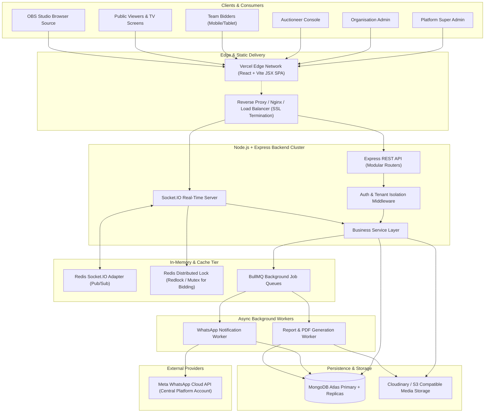
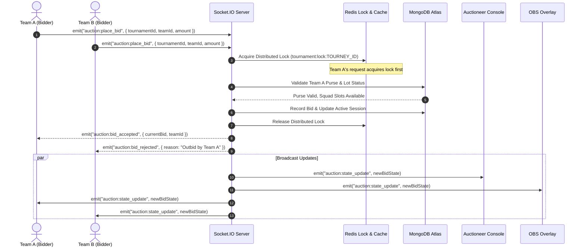
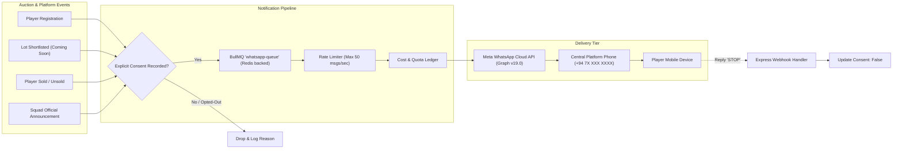
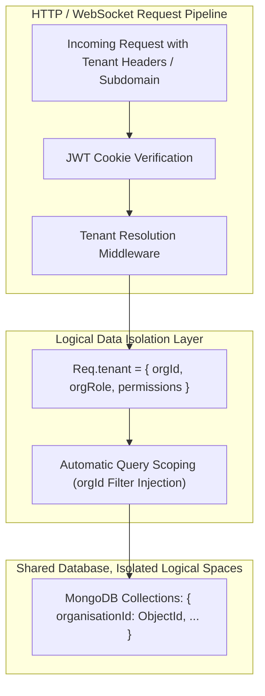

# Cricket Auction Management Platform - System Architecture

## 1. High-Level Architecture

The platform uses a decoupled, multi-tier client-server architecture with dedicated real-time synchronization, asynchronous background worker queues, and centralized third-party integrations.



---

## 2. Layered Component Architecture

### 2.1 Frontend Architecture (React + Vite + Tailwind CSS JSX)
The frontend is built as a single-page application (SPA) with React and Vite. In accordance with strict development rules, **100% of frontend code is written in pure JavaScript and JSX (no TypeScript/TSX).**

```
/client
├── public/                 # Static assets, favicon, sounds (gavel.mp3, bid.mp3, timer.mp3)
├── src/
│   ├── assets/             # Images, vector icons, tournament placeholders
│   ├── components/         # Reusable atomic UI elements
│   │   ├── common/         # Buttons, Badges, Modals, Loaders, Alerts, Inputs
│   │   ├── layout/         # AppLayout, AdminSidebar, TopNavbar, Breadcrumbs
│   │   ├── auction/        # LiveBidHistory, CurrentLotCard, TimerRing, HammerGavel
│   │   ├── team/           # TeamCard, PurseProgress, SquadRosterList
│   │   └── obs/            # LowerThirdOverlay, LiveTicker, SponsorBar, BigCard
│   ├── context/            # React Contexts (AuthContext, SocketContext, TenantContext)
│   ├── hooks/              # Custom React hooks (useAuctionSocket, useAudio, useTimer, useApi)
│   ├── pages/              # Route views
│   │   ├── auth/           # Login, Register, ForgotPassword
│   │   ├── superadmin/     # Platform Management, All Orgs, WhatsApp Billing
│   │   ├── admin/          # Org Dashboard, Tournaments, Teams, Players, Categories
│   │   ├── auctioneer/     # Real-time Auction Master Console
│   │   ├── bidder/         # Franchise Team Live Bidding Console (Mobile/Tablet)
│   │   ├── public/         # Public Live Stream Viewer, Player Self-Registration
│   │   └── obs/            # Transparent Chroma/Web Overlays for OBS Studio
│   ├── services/           # Axios instance with credentials, API endpoint bindings
│   ├── utils/              # Currency/Points formatters, date helpers, cricket calculators
│   ├── App.jsx             # Route definitions with role-based Route Guards
│   └── main.jsx            # Entry point with Tailwind CSS imports
```

#### Frontend State & Real-Time Sync Strategy:
- **Authentication State**: Stored in `AuthContext` backed by a `/api/v1/auth/me` bootstrap check. Tokens are never stored in `localStorage` or `sessionStorage` (preventing XSS theft). All authentication relies on HTTP-only, secure, same-site cookies.
- **Auction Real-Time State**: Handled via custom hook `useAuctionSocket(tournamentId)`. Listens to Socket.IO room events and maintains an immutable auction reducer:
  - `activeLot`: Currently auctioned player object with statistics and photos.
  - `currentBid`: Current highest bid value and bidding team.
  - `bidHistory`: Stack of bids placed during this lot.
  - `timerRemaining`: Synced server-side countdown.
  - `teams`: Live purse updates for all franchise teams.
- **Broadcast Overlays**: Lightweight, stripped-down routes without layout bars or sidebars, styled with transparent CSS body backgrounds (`background: transparent;`).

---

### 2.2 Backend Architecture (Node.js + Express.js Modular Architecture)
The backend follows a clean, layered architectural pattern. Controllers remain strictly "thin," delegating all database transactions, calculations, and external dispatching to specialized domain services.

```
/server
├── src/
│   ├── config/             # DB connection, Redis, Cloudinary, WhatsApp, JWT config
│   ├── constants/          # Roles, Auction status, Cricket roles, Event names
│   ├── controllers/        # Thin HTTP request parsers & response formatters
│   ├── middleware/         # Auth, Tenant Context, RBAC, Validator, RateLimiter, Error
│   ├── models/             # Mongoose schemas & indexes
│   ├── queues/             # BullMQ queue definitions & job workers
│   │   ├── whatsapp.queue.js
│   │   ├── whatsapp.worker.js
│   │   └── export.worker.js
│   ├── routes/             # Modular Express routers
│   ├── services/           # Core domain logic
│   │   ├── auth.service.js
│   │   ├── organisation.service.js
│   │   ├── tournament.service.js
│   │   ├── team.service.js
│   │   ├── player.service.js
│   │   ├── auction.service.js      # Critical bidding engine & purse validations
│   │   ├── whatsapp.service.js     # Meta Cloud API & consent governance
│   │   └── report.service.js       # CSV & PDF generation
│   ├── sockets/            # Socket.IO handlers & rooms
│   │   ├── auction.socket.js
│   │   └── socket.middleware.js    # Cookie-based auth for WebSocket connections
│   ├── utils/              # ApiError, ApiResponse, Logger, Cricket validators
│   ├── app.js              # Express app configuration & middleware pipeline
│   └── server.js           # Server bootstrap (HTTP + Socket.IO + Database)
```

---

## 3. Real-Time Bidding Engine (Concurrency & Race Prevention)

In a live auction, multiple team owners might click "Bid" simultaneously (within milliseconds). To prevent race conditions, double bidding, or negative purse balances:



### Critical Concurrency Protections:
1. **Redis Mutex / Distributed Lock**: Prior to processing any bid for a given `tournamentId`, a lightweight Redis lock with a 500ms auto-expiration is acquired. Subsequent bids within that window queue or fail gracefully with `"Outbid by competitor"`.
2. **Server-Authoritative Clock**: Timers (e.g., 15-second countdown after a bid) are maintained exclusively on the server. Clients receive sync signals (`auction:timer_tick`) and never dictate auction state transitions.
3. **Optimistic Concurrency & Transactional Updates**: Updates to team purses and lot states use atomic MongoDB operations (`findOneAndUpdate` with pre-condition checks) to guarantee that a team cannot spend more points/money than their available balance.
4. **Calculated Maximum Safe Bid Constraint**: The engine dynamically calculates a team's **Maximum Permissible Bid**:
   $$\text{MaxBid} = \text{PurseRemaining} - (\text{RemainingRequiredSlots} - 1) \times \text{MinBasePrice}$$
   This ensures a team cannot spend all its funds on one star player and end up with an incomplete squad.

---

## 4. Central WhatsApp Notification Architecture



### WhatsApp Operational Tenets:
- **Zero Cost to Tenants**: All WhatsApp messaging fees from Meta are billed directly to the platform's central credit balance.
- **Opt-In Requirement**: Players must check an explicit opt-in box during registration. The system logs their phone number, consent timestamp, and IP address.
- **Immediate Opt-Out Mechanism**: Any player replying "STOP", "UNSUBSCRIBE", or clicking an opt-out link in the initial welcome SMS/WhatsApp message triggers an instant automatic consent revocation.
- **Pre-Approved Template Messaging**: In accordance with Meta guidelines, all transactional messages outside the 24-hour service window use pre-approved WhatsApp message templates with dynamic placeholders (e.g., `{{player_name}}`, `{{team_name}}`, `{{sold_price}}`).

---

## 5. OBS Broadcasting & Transparent Overlays

Broadcast graphics are delivered as dedicated, high-performance web pages that render cleanly at 60 FPS in standard browser engines:

```
http://platform-domain.com/overlay/live/{tournamentId}?key={streamKey}&theme=dark
```

### Technical Specs:
- **Resolution**: 1920 x 1080 (Full HD, 16:9).
- **Background**: `background: rgba(0, 0, 0, 0);` (Full Alpha Channel transparency for Chroma / Direct Browser Source in OBS Studio).
- **Update Mechanism**: Direct WebSocket connection without browser reloads. When the auctioneer changes a lot or a bid is accepted, CSS transitions (keyframes, slide-ins, pulse glows) trigger instantaneously.
- **Audio Feedback**: Configurable audio output for stream audio mixers (hammer strikes, outbid warnings, timer ticking).
- **Stream Key Authentication**: Overlays use read-only ephemeral or long-lived secret stream keys so broad access to the broadcast URL does not require user credentials or compromise administrative tokens.

---

## 6. Multi-Tenant Isolation Strategy



- **Shared Database, Shared Schema**: Single MongoDB Atlas cluster with strict logical data partitioning via an indexed `organisationId` field on all tenant-specific documents.
- **Tenant Context Injection**: A custom Express middleware (`requireTenantContext`) resolves the organisation from either the authenticated user's session or the route slug, enforcing that users can only read or mutate records belonging to their active organisation.
- **Cross-Tenant Prevention**: Repository/Service query helpers automatically append `{ organisationId: req.tenant.id }` to prevent unintentional cross-tenant leakage.
- **Platform Super Admin Override**: Platform admins possess cross-tenant query bypass capabilities strictly for support and managed event execution.

---

## 7. Deployment & Infrastructure Topology

| Component | Target Hosting Provider | Scaling Strategy |
|---|---|---|
| **Frontend SPA** | Vercel | Global Edge CDN, automated atomic deployments via Git |
| **Backend REST & Socket.IO** | Node.js container (Render / Railway / AWS ECS) | Horizontal auto-scaling with Redis adapter for Socket.IO |
| **Worker Processes** | Dedicated Node.js background worker instance | Scaled independently based on BullMQ queue depth |
| **Database** | MongoDB Atlas (Replica Set M10+) | Auto-scaling storage, automated backups, multi-AZ high availability |
| **Redis & Queue Tier** | Redis Cloud / Upstash / AWS ElastiCache | In-memory persistence, low-latency Pub/Sub & BullMQ backend |
| **Media Assets** | Cloudinary / AWS S3 Compatible | On-the-fly image transformations, face cropping for player badges |
| **WhatsApp Provider** | Meta Graph Cloud API | Official Meta endpoints with webhook callbacks |
