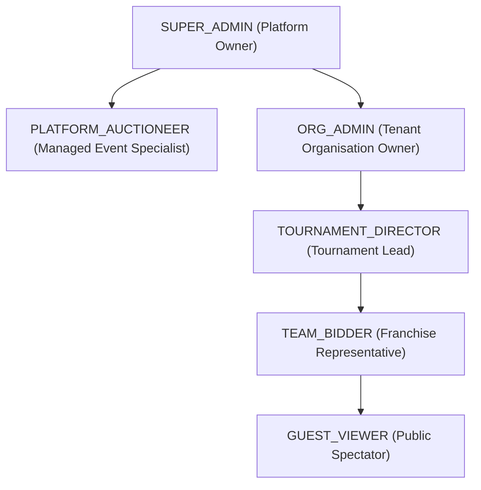

# Cricket Auction Management Platform - User Roles & Permissions

## 1. Role Hierarchy Overview

The platform uses a role-based access control (RBAC) model combined with tenant context isolation.

---

## 2. Role Definitions

### 2.1 `SUPER_ADMIN` (Platform Operator)
- **Scope**: Platform-wide (Cross-tenant).
- **Responsibilities**:
  - Provision, monitor, and suspend organisation tenants.
  - Oversee central WhatsApp Business Account health, billing, and Meta API rate limits.
  - Assign platform-managed auctioneers to client tournaments.
  - Access global audit trails, revenue metrics, and system diagnostic logs.

### 2.2 `PLATFORM_AUCTIONEER` (Managed Events Staff)
- **Scope**: Multi-tenant operational assignment.
- **Responsibilities**:
  - Acts as the professional master of ceremonies / auctioneer on auction day for client organisations that purchased managed event packages.
  - Control the live auction flow (introduce lots, initiate countdowns, trigger hammer calls, confirm sold/unsold, pause/resume).
  - Override erroneous bids under explicit instruction from the tournament committee.
  - No access to tenant billing or organization deletion.

### 2.3 `ORG_ADMIN` (Organisation Owner / Client)
- **Scope**: Tenant-isolated (`organisationId`).
- **Responsibilities**:
  - Full control over their organisation profile, brand settings, and staff users.
  - Create and configure multiple tournaments and seasons.
  - Set starting team purses, squad composition limits, and bid ladders.
  - Manage franchise teams and assign team bidder credentials.
  - Verify and approve registered players, import CSV rosters, set base prices and lot order.
  - Retrieve OBS broadcast keys and export final official team rosters.

### 2.4 `TOURNAMENT_DIRECTOR` (Tournament Manager)
- **Scope**: Scoped to specific assigned tournament(s) within the tenant organisation.
- **Responsibilities**:
  - Perform operational player approvals, verify identity documents, and assign auction lots.
  - Run the auction console (if self-service tier is chosen instead of platform-managed auctioneer).
  - Print/download match sheets and official squad reports.

### 2.5 `TEAM_BIDDER` (Franchise Representative)
- **Scope**: Bound strictly to one designated `teamId` in a specific tournament.
- **Responsibilities**:
  - Real-time bidding on the interactive bidder terminal during live auction lots.
  - Live view of remaining team purse, acquired squad roster, role balance breakdown, and maximum allowed bid.
  - Cannot place bids for other teams, alter starting prices, or access administrative menus.

### 2.6 `GUEST_VIEWER` (Spectator / Public)
- **Scope**: Public, read-only.
- **Responsibilities**:
  - View real-time auction lots, recent bids, and team purse standings via the web viewer or OBS stream.
  - Register as a player via public tournament sign-up links.

---

## 3. Detailed Permission Matrix

| Capability / Resource | `SUPER_ADMIN` | `PLATFORM_AUCTIONEER` | `ORG_ADMIN` | `TOURNAMENT_DIRECTOR` | `TEAM_BIDDER` | `GUEST_VIEWER` |
|---|:---:|:---:|:---:|:---:|:---:|:---:|
| **Manage All Organisations** | ✅ | ❌ | ❌ | ❌ | ❌ | ❌ |
| **Manage WhatsApp Billing & Costs**| ✅ | ❌ | View Credits | ❌ | ❌ | ❌ |
| **Assign Managed Auctioneers** | ✅ | ❌ | Request Only | ❌ | ❌ | ❌ |
| **Create / Delete Tournaments** | ✅ | ❌ | ✅ | ❌ | ❌ | ❌ |
| **Configure Squad Rules & Purse** | ✅ | ❌ | ✅ | ✅ | ❌ | ❌ |
| **Create / Manage Teams** | ✅ | ❌ | ✅ | ✅ | ❌ | ❌ |
| **Assign Bidder Credentials** | ✅ | ❌ | ✅ | ✅ | ❌ | ❌ |
| **Bulk CSV Import Players** | ✅ | ❌ | ✅ | ✅ | ❌ | ❌ |
| **Approve / Categorize Players** | ✅ | ❌ | ✅ | ✅ | ❌ | ❌ |
| **Control Auction Gavel / Lots** | ✅ | ✅ | ✅ | ✅ | ❌ | ❌ |
| **Place Real-Time Live Bids** | ❌ (Conflict) | ❌ (Conflict) | ❌ | ❌ | ✅ (Own Team) | ❌ |
| **Administrative Bid Override** | ✅ | ✅ | ✅ | ❌ | ❌ | ❌ |
| **Access OBS Secret Stream Key** | ✅ | ✅ | ✅ | ✅ | ❌ | ❌ |
| **View Live Transparent Overlays**| ✅ | ✅ | ✅ | ✅ | ✅ | ✅ (Via Key) |
| **Export Official Squad PDFs** | ✅ | ✅ | ✅ | ✅ | ✅ (Own Team) | ❌ |
| **View Audit Logs** | ✅ | ❌ | ✅ (Tenant) | ❌ | ❌ | ❌ |

---

## 4. Enforcement Architecture

### 4.1 REST API Route Guards
- `verifyAuthCookie`: Extracts JWT from HTTP-only cookie and attaches `req.user`.
- `requireRole([...allowedRoles])`: Validates user role against the permitted list.
- `requireTenantScope`: Verifies that `req.params.orgId` or the tournament's `organisationId` matches `req.user.organisationId` (bypassed only for `SUPER_ADMIN`).
- `requireTeamBidderMatch`: Ensures a `TEAM_BIDDER` can only interact with routes affecting their specific `assignedTeamId`.

### 4.2 WebSocket Event Guards
When a Socket.IO connection is established:
1. The handshake cookie is verified via JWT middleware; `socket.user` is populated.
2. When `auction:place_bid` is emitted, the server checks:
   - Does `socket.user.role === 'TEAM_BIDDER'`?
   - Does `socket.user.assignedTeamId === payload.teamId`?
   - Is `socket.rooms` subscribed to the target `tournamentId`?
3. Non-authorized bid emits are instantly rejected with `auction:error` events.
